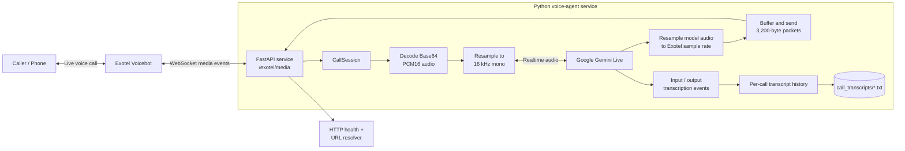
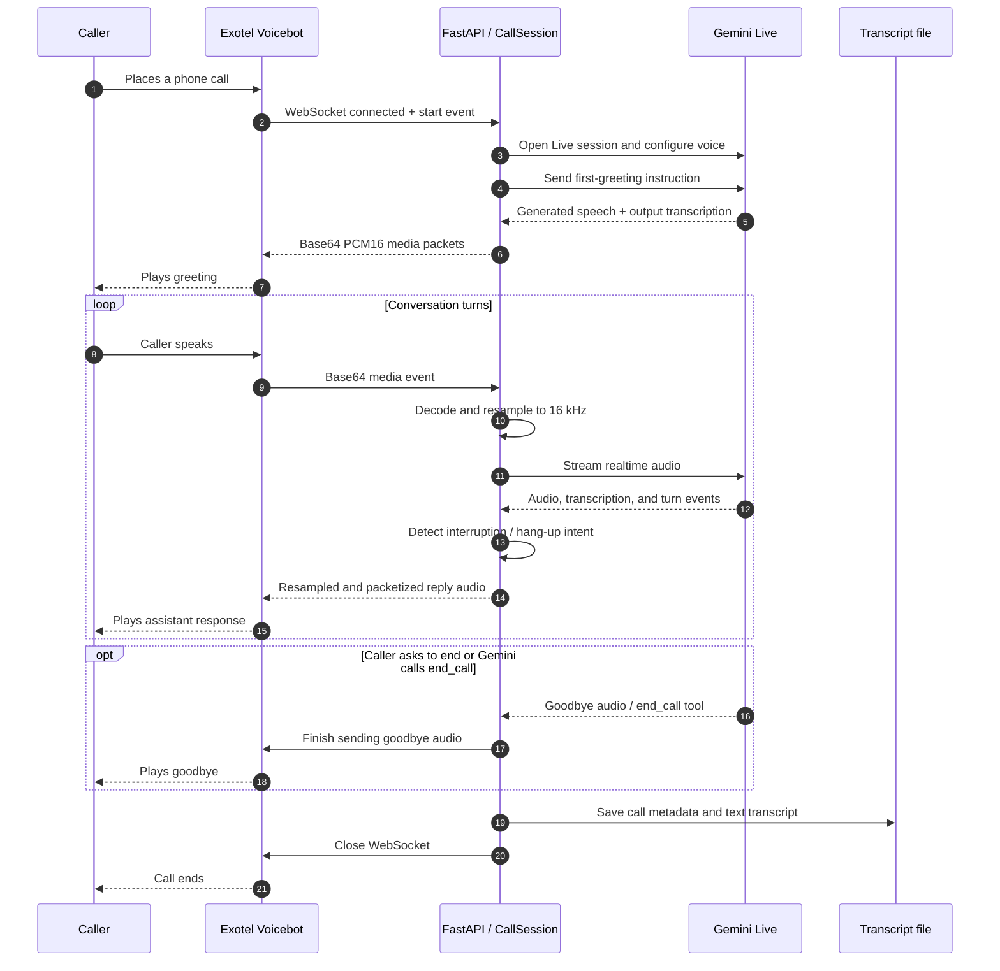

# Gemini Live × Exotel Voice Agent

**A real-time, bidirectional AI phone assistant built with FastAPI, Exotel Voicebot WebSockets, and Google Gemini Live.** It receives a caller's audio stream, sends it to Gemini Live for conversational understanding and speech generation, and streams the generated audio back to the phone call.

The service also captures Gemini's input/output transcription events and saves a separate, human-readable text transcript for every call that reaches Exotel's `start` event.

<p align="left">
  
  
  
  
  
</p>

---

## At a glance

| | |
|---|---|
| **Project type** | Real-time AI voice / telephony application |
| **Backend** | FastAPI + Uvicorn |
| **Telephony layer** | Exotel Voicebot WebSocket stream |
| **AI layer** | Google Gemini Live API (`google-genai`) |
| **Audio format** | Mono PCM16, with streaming sample-rate conversion |
| **Call records** | One text transcript per started call |
| **Interface** | Phone call; HTTP health and URL-resolver endpoints |

## Why this project

Most voice-assistant demos stop at a text chatbot or a one-way text-to-speech response. This project connects a real phone-call media stream to a live multimodal model and handles the operational details around an actual conversation: audio format conversion, continuous streaming, caller interruptions, turn transcription, goodbye handling, and call cleanup.

It is a practical foundation for experimenting with AI phone assistants, conversational IVR experiences, and voice-based customer interactions.

## Key capabilities

- **Real-time, two-way audio:** streams caller audio to Gemini Live and sends generated speech back through Exotel while the call is active.
- **Agent speaks first:** sends an internal greeting instruction as soon as the call session is ready.
- **Language-adaptive conversation:** the system prompt instructs Gemini to reply in the language used by the caller, including English, Hindi, and Hinglish, subject to the selected model's language capabilities.
- **Voice activity detection controls:** configurable silence duration helps determine when the caller has finished a turn.
- **Barge-in handling:** when Gemini reports an interruption, queued output is cleared at Exotel so the caller can speak over the assistant.
- **Intentional call ending:** recognizes explicit phrases such as “hang up,” “end the call,” and “goodbye.” Gemini can also invoke the `end_call` function after speaking a goodbye.
- **Playback-aware hang-up:** waits for the goodbye audio to play, with configurable timeout safeguards.
- **Per-call transcripts:** stores caller and agent text with call identifiers and UTC timestamps, including partial text captured before an unexpected disconnect.
- **Operational visibility:** call-aware logs, audio diagnostics, Gemini event diagnostics, and approximate first-reply-audio latency logging.
- **Optional WebSocket access token:** protects the media endpoint with a shared secret when `EXOTEL_WS_TOKEN` is configured.

> **Audio privacy:** the application stores text received through Gemini Live transcription events. It does **not** record or archive the raw call audio.

---

## Architecture

### High-level system design



### One call, end to end



### Audio pipeline

The service handles the format differences between the telephony stream and Gemini Live:

| Stage | Audio format |
|---|---|
| Exotel input | Mono PCM16 at 8 kHz, 16 kHz, or 24 kHz |
| Gemini Live input | Mono PCM16 at 16 kHz |
| Gemini Live output | Mono PCM16 at 24 kHz |
| Exotel output | Mono PCM16 converted to the call's sample rate |

`StreamResampler` uses **soxr** for stateful streaming conversion. The Exotel sender buffers outgoing audio into 3,200-byte packets, Base64-encodes each packet, and pads the final partial packet with silence when necessary.

### Concurrent call-session tasks

Each `CallSession` coordinates four concurrent tasks:

1. **Exotel → Gemini:** reads media events, decodes caller audio, resamples it, and streams it to Gemini.
2. **Gemini reader:** continuously drains model responses into an asynchronous queue so incoming events are not held up by audio processing.
3. **Gemini processor → Exotel:** handles generated audio, transcription fragments, interruptions, function calls, and completed turns.
4. **Hang-up watcher:** coordinates session shutdown after the goodbye flow or its timeout safeguard.

This separation keeps WebSocket ingestion, model response reading, and outbound audio processing from being implemented as one blocking loop.

---

## Repository layout

```text
telephony/
├── voice_agent/
│   ├── __init__.py
│   ├── audio.py             # PCM16 helpers and stateful streaming resampling
│   ├── config.py            # .env discovery, settings, and required-key validation
│   ├── exotel.py            # Exotel event parsing and outbound media packet sender
│   ├── gemini.py            # Gemini Live setup, audio configuration, and end_call tool
│   ├── hangup.py            # Explicit caller hang-up phrase detection
│   ├── logging_setup.py     # Structured, call-ID-aware console logging
│   ├── main.py              # FastAPI routes and Exotel WebSocket endpoint
│   ├── metrics.py           # Approximate first-audio response latency tracking
│   ├── prompts.py           # Assistant system prompt and first greeting instruction
│   ├── session.py           # Per-call orchestration and lifecycle management
│   └── transcripts.py       # Safe filenames and atomic transcript-file writing
├── tests/
│   ├── test_audio.py        # PCM helpers and streaming resampler tests
│   ├── test_exotel.py       # Event parsing and audio-packet tests
│   ├── test_hangup.py       # Explicit / negated hang-up phrase tests
│   ├── test_session_smoke.py # WebSocket session smoke test with fake Gemini
│   └── test_transcripts.py  # Per-call transcript persistence tests
├── call_transcripts/        # Generated locally; ignored by Git
├── conftest.py
├── requirements.txt
├── .gitignore
└── README.md
```

---

## Technology stack

| Technology | Role in the project |
|---|---|
| **Python 3.10+** | Application language and asynchronous orchestration |
| **FastAPI** | HTTP endpoints and WebSocket handling |
| **Uvicorn** | ASGI application server |
| **Google Gemini Live** | Real-time audio conversation and transcription events |
| **Exotel Voicebot** | Phone-call connectivity and media streaming |
| **NumPy** | PCM16 sample conversion and audio-level calculations |
| **soxr** | High-quality streaming sample-rate conversion |
| **python-dotenv** | Environment-based configuration |
| **pytest + HTTPX** | Unit and application-level tests |

---

## Getting started

### 1. Prerequisites

Before running the service, make sure you have:

- Python **3.10 or newer**.
- An Exotel account and a phone number/app configuration that supports Voicebot WebSocket streaming.
- A Google Gemini API key with access to a compatible Gemini Live model.
- A publicly reachable HTTPS/WSS endpoint for the Exotel service to connect to. A tunnel such as [ngrok](https://ngrok.com/) can be used during local development.

### 2. Clone and enter the project

```bash
git clone <YOUR_REPOSITORY_URL>
cd <YOUR_REPOSITORY_DIRECTORY>
```

If you have already downloaded this project, open a terminal in the directory containing `requirements.txt`. The commands below assume that directory is the repository root.

### 3. Create a virtual environment

**Windows PowerShell**

```powershell
python -m venv .venv
.\.venv\Scripts\Activate.ps1
```

**macOS / Linux**

```bash
python3 -m venv .venv
source .venv/bin/activate
```

### 4. Install dependencies

```bash
python -m pip install --upgrade pip
pip install -r requirements.txt
```

### 5. Configure environment variables

Create a file named `.env` in the project root (the same directory as `requirements.txt`) and add your credentials and public WebSocket URL:

```dotenv
GEMINI_API_KEY=your_google_gemini_api_key
GEMINI_LIVE_MODEL=your_available_gemini_live_model
EXOTEL_WS_URL=wss://your-public-domain/exotel/media

# Optional: require Exotel to provide this token on the WebSocket URL.
# EXOTEL_WS_TOKEN=replace_with_a_long_random_secret
```

The three required variables are:

| Variable | Description |
|---|---|
| `GEMINI_API_KEY` | Google Gemini API key. |
| `GEMINI_LIVE_MODEL` | Gemini Live model identifier available to your API key. |
| `EXOTEL_WS_URL` | Public secure WebSocket URL for the media endpoint, normally ending in `/exotel/media`. |

The application searches for `.env` starting from the `voice_agent` package directory and moving up through parent directories. The project-root `.env` is the recommended location. **Never commit your real `.env` file or expose your API key.**

### 6. Start the server

Run this command from the project root:

```bash
uvicorn voice_agent.main:app --host 0.0.0.0 --port 8000
```

The service will listen on port `8000`.

### 7. Expose the local server

For local testing, expose port `8000` through a secure public tunnel:

```bash
ngrok http 8000
```

Use the tunnel's public HTTPS hostname to construct the WebSocket URL. For example:

```text
https://YOUR-NGROK-DOMAIN/       -> URL resolver
wss://YOUR-NGROK-DOMAIN/exotel/media -> media WebSocket
```

Set `EXOTEL_WS_URL` to the `wss://.../exotel/media` address and restart Uvicorn after changing `.env`.

---

## Exotel configuration

1. Create or open the Exotel Voicebot applet associated with your phone number.
2. Configure the applet to use the service's dynamic URL resolver, `https://YOUR-DOMAIN/`, if that option is available. The resolver responds with `{"url": "<EXOTEL_WS_URL>"}`. Otherwise, configure the WebSocket URL directly if supported by your applet setup.
3. The media endpoint is `wss://YOUR-DOMAIN/exotel/media`.
4. Set the applet's **Next Applet** to **Hangup**. The service closes the media WebSocket when the conversation is finished so Exotel can continue to the next applet.
5. Place a test call and inspect the server logs for the call identifier, Gemini events, and transcript-save message.

### Optional WebSocket token

To require a shared secret, set `EXOTEL_WS_TOKEN` in `.env`. Exotel must then connect using the token as a query parameter:

```text
wss://YOUR-DOMAIN/exotel/media?token=YOUR_SHARED_TOKEN
```

The service compares the supplied token before accepting the WebSocket connection. Use a long, randomly generated value and keep it private.

---

## HTTP and WebSocket endpoints

| Method | Path | Purpose |
|---|---|---|
| `GET` | `/` | Exotel dynamic URL resolver; returns the configured WebSocket URL in a JSON object. |
| `GET` | `/health` | Lightweight health response containing service status and configured Gemini model. |
| `WS` | `/exotel/media` | Receives Exotel call events and media packets, then streams generated audio back. |

Example health response:

```json
{
  "status": "online",
  "service": "Gemini Exotel Voice Agent",
  "model": "<configured-gemini-live-model>"
}
```

---

## Call transcripts

Once Exotel sends a valid `start` event, the application saves one text file when the call session closes.

**Default output directory**

```text
call_transcripts/
```

**Filename pattern**

```text
call_no_<EXOTEL_CALL_SID>.txt
```

The Exotel call SID is used as the call identifier. If it is unavailable, the stream SID is used as a fallback. The `Call No` value is an identifier; it is **not** the caller's phone number.

Each transcript includes:

- Call identifier, call SID, and stream SID.
- Call start and end timestamps in UTC.
- Caller and agent text, grouped by completed conversation turns.
- A diagnostic note when no transcription text was received.

Transcript writing also preserves partial transcription fragments captured before a disconnect. Files are written through a temporary file and renamed into place after writing, reducing the chance of leaving a partially written final transcript.

### Change the transcript directory

Set `CALL_TRANSCRIPT_DIR` in `.env`:

```dotenv
CALL_TRANSCRIPT_DIR=call_transcripts
```

Relative paths are resolved from the project root. Absolute paths are supported as well. Ensure the application process has permission to write to the configured directory. For a deployment where instances can be replaced, use persistent storage if transcripts must survive instance replacement.

### Privacy and retention

Transcripts can contain personal information spoken during calls. The repository's `.gitignore` excludes the default `call_transcripts/` directory. For any real deployment, restrict filesystem/storage access, define a retention and deletion policy, and provide caller notices or obtain consent where required by applicable law and your deployment policy. This implementation stores text transcripts only; it does not save raw audio recordings.

---

## Configuration reference

Only the three credentials/connection settings listed in the setup section are required. The remaining settings have defaults in `voice_agent/config.py` and can be overridden through `.env` or the process environment.

| Variable | Default | Description |
|---|---:|---|
| `EXOTEL_WS_TOKEN` | Unset | Optional shared secret required as `?token=...` on the media WebSocket URL. |
| `VOICE_NAME` | `Puck` | Gemini prebuilt voice name. |
| `GREETING_TRIGGER` | Built-in instruction | Internal text instruction that makes the agent greet the caller first. |
| `VAD_SILENCE_MS` | `600` | Silence duration used by Gemini automatic activity detection; `0` leaves this setting to Gemini. |
| `GREETING_PROTECT_SECONDS` | `4.0` | Maximum initial period during which caller audio is ignored while the greeting plays; `0` disables this protection. |
| `GOODBYE_TIMEOUT_SECONDS` | `10.0` | Safety timeout for completing the goodbye flow before forcing hang-up. |
| `MAX_PLAYBACK_WAIT_SECONDS` | `15.0` | Maximum wait for goodbye audio playback. |
| `PLAYBACK_MARGIN_SECONDS` | `0.5` | Extra playback wait margin. |
| `IDLE_WARN_SECONDS` | `10.0` | Logs a warning if no Gemini message arrives within this interval. |
| `RECENT_TURN_SECONDS` | `5.0` | Window used to recognize goodbye audio completed just before the `end_call` tool event. |
| `START_EVENT_TIMEOUT_SECONDS` | `30.0` | Maximum wait for Exotel's `start` event. |
| `RAW_RESPONSES_TO_LOG` | `5` | Number of initial raw Gemini responses included in diagnostic logs. |
| `LOG_LEVEL` | `INFO` | Console logging level. |
| `CALL_TRANSCRIPT_DIR` | `call_transcripts` | Directory used for per-call transcript files. |

---

## Running the tests

Install the project dependencies first, then run from the project root:

```bash
pytest -q
```

The test suite covers:

| Test module | Coverage |
|---|---|
| `test_audio.py` | PCM16 conversion, same-rate passthrough, up/down-sampling, odd-sized chunks, and RMS calculation. |
| `test_exotel.py` | Exotel message parsing, start-event validation, Base64 media decoding, packet buffering, flush, and clear events. |
| `test_hangup.py` | Explicit hang-up phrases and phrases that must not trigger a hang-up. |
| `test_transcripts.py` | Per-call file creation, safe identifier handling, metadata, and empty-transcript fallback. |
| `test_session_smoke.py` | A FastAPI WebSocket smoke test using a fake Gemini session; no live Gemini API or Exotel call is made. |

---

## Troubleshooting

| Symptom | What to check |
|---|---|
| Missing `.env` keys | Confirm the project-root `.env` contains `GEMINI_API_KEY`, `GEMINI_LIVE_MODEL`, and `EXOTEL_WS_URL`. Restart Uvicorn after edits. |
| Exotel cannot connect | Confirm the public HTTPS/WSS tunnel is running, the URL ends in `/exotel/media`, and the applet resolver/direct URL is configured correctly. |
| WebSocket closes immediately | Inspect logs for a rejected token, invalid `start` event, unsupported sample rate, or Gemini connection failure. |
| Agent does not greet first | Check the Gemini API key and model access. Look for `Greeting trigger sent` and subsequent Gemini events in the logs. |
| Caller speech is not understood | Verify the Exotel sample rate and inspect packet/RMS diagnostics. Try `VAD_SILENCE_MS=0` to use Gemini's default activity detection if the configured value causes a setup error. |
| Transcript has no conversation text | Transcripts are built from Gemini Live input/output transcription events, not from stored audio. Check that those events are being returned and that the model/API configuration is correct. |
| Transcript file is missing | Confirm the call reached Exotel's `start` event, the output directory is writable, and logs show `Call transcript saved` rather than a save error. |
| Responses feel too slow or turns end too early | Adjust `VAD_SILENCE_MS`. A lower value may shorten pauses before a response but can also cause speech pauses to be treated as turn boundaries sooner. |

---

## Current limitations and production considerations

This repository is a working service foundation, not a complete contact-center platform. The current implementation has the following boundaries:

- No database, transcript search, administration dashboard, or browser-based call console; transcripts are local text files.
- No raw call audio recording or playback archive.
- Transcript completeness depends on Gemini Live returning input and output transcription events.
- No human call transfer, outbound follow-up, SMS/email, reminders, or external actions; the voice prompt explicitly limits the assistant to the current phone conversation.
- Local transcript files need persistent storage in deployments where instances are ephemeral.
- Production use should add deployment-specific monitoring, access control, secret management, storage durability, capacity testing, and a caller privacy/consent/retention policy.

## Potential extensions

The existing module boundaries provide clear places to extend the project:

- Persist transcripts and call metadata in PostgreSQL or another managed database.
- Add a secure dashboard for call history, transcript search, and operational metrics.
- Export application metrics to a monitoring stack and add alerting for failed sessions or elevated response latency.
- Add configurable business-specific prompts, call flows, and integrations for approved use cases.
- Move transcript storage to durable object storage with explicit retention controls.

These are possible next steps, not features currently implemented in this repository.

---
